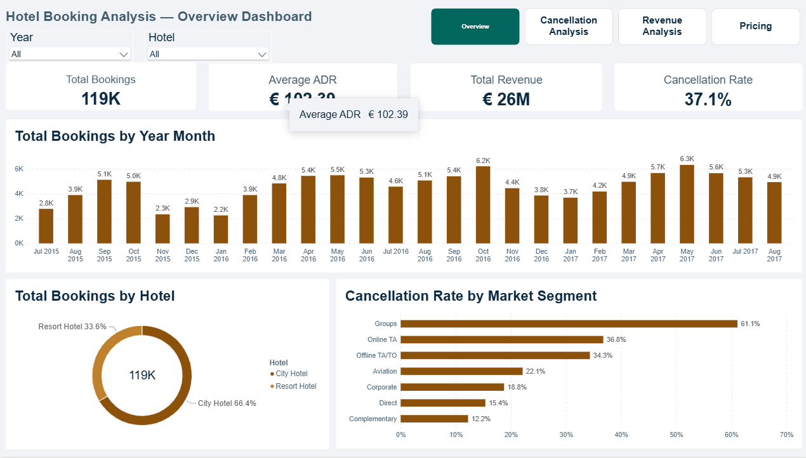
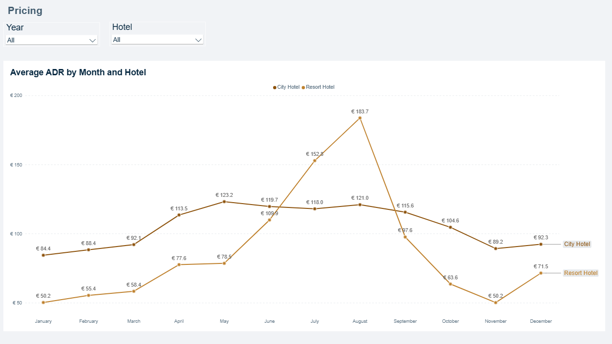

# Cancellation & Guest Behavior Analysis (SQL Server + Power BI)

An end-to-end analytics project on hotel booking data: raw CSV is loaded into SQL Server, cleaned and analysed in T-SQL, then explored in a four-page Power BI dashboard.

**Project question:** Which bookings are most likely to be cancelled, where does revenue come from, and how do pricing and seasonality behave across two hotels in Portugal?

---

## Why this project

I have 8+ years of hotel reservations experience, where cancellations, lead time and deposit policy directly affect revenue. This project looks at the same questions with data: who cancels, how early they book, and which segments bring in revenue.

## Key findings

| # | Finding | Evidence |
|---|---------|----------|
| 1 | **Non Refund "paradox" explained: these are group blocks, not guests.** | 14,587 `Non Refund` bookings cancel at **99.4%** (28.4% for all others). 97.2% come from Portugal, 97.2% are Groups or Offline TA/TO, 88.2% are at the City Hotel. Average lead time is 213 days (89 for others) and special requests are almost zero (0.002 vs 0.651). They look like room blocks held by tour operators and group organisers, then released. |
| 2 | **Most of the City vs Resort cancellation gap comes from those blocks.** | City 41.8% vs Resort 27.8% (14.0-point gap). Excluding Non Refund: City 30.5% vs Resort 24.7% (5.8-point gap). About 60% of the gap comes from where the blocks sit, not from the hotels themselves. |
| 3 | **Lead time matters.** | Cancelled bookings were made 144.9 days ahead on average vs 80.1 days for bookings that were kept. |
| 4 | **Special requests and previous cancellations are strong warning signals.** | No special requests: 47.8% cancelled (34.3% excluding Non Refund) vs 21.8% with one or more. A previous cancellation: 91.7% (81.0% excluding Non Refund) vs 33.9% without. Both signals hold after removing the blocks. |
| 5 | **Summer revenue is driven by Resort pricing, not volume.** | Resort ADR rises from €50 in January to €184 in August (3.7x). City ADR stays within €84 to €123. In 2016, the only complete year, October has the most arrivals. |
| 6 | **Portugal leads bookings and revenue.** | Portugal (PRT) has 48,483 bookings and about €5.54M revenue. |
| 7 | **Online travel agents are the top revenue segment.** | Online TA brings in about €13.7M. |
| 8 | **Cancellations put about €16.7M of potential revenue at risk.** | Cancelled bookings would have been worth about €16.7M (City €10.9M, Resort €5.8M) under the same revenue rule, against €26.0M realised. This is an upper bound, because some cancelled rooms are resold. |

## Recommendations

**1. Manage group blocks separately (City Hotel).**
Review group-block contracts and add release dates, for example unnamed rooms return to inventory 30 days before arrival. Track block pick-up rate per operator, and report guest cancellation rate separately from block release. *Why:* the blocks lift the City Hotel's cancellation rate from 30.5% to 41.8% and hold inventory that could be sold to individual guests.

**2. Protect Resort summer rates.**
Keep June to August inventory for high-rate bookings and avoid early discounting. *Why:* the summer revenue peak comes from rate (ADR €184 in August vs €50 in January), not from more bookings. The City Hotel's revenue depends more on filling rooms.

**3. Use booking-time signals to flag risk.**
Treat bookings with a previous cancellation as high risk (ask for a deposit or reconfirm closer to arrival), and encourage guests to add special requests such as transfers or room preferences. *Why:* both signals are known at booking time and stay strong after excluding the Non Refund blocks.

> **Caveat:** the dataset has no field that labels block allocations. The block pattern is inferred from segment, lead time and the absence of special requests, and should be confirmed with a reservations team. Signals show correlation, not causation.

## Business questions

A hotel group operating a **City Hotel** and a **Resort Hotel** wants to understand:

1. Which bookings are most likely to be cancelled, and why?
2. Where does revenue come from (market segment, country, hotel)?
3. How do pricing (ADR) and seasonality behave over time?

## Dataset

- **Source:** *Hotel Booking Demand* (Antonio, Almeida & Nunes, 2019)
- **Size:** 119,390 rows × 32 columns (one row = one booking)
- **Period:** 1 Jul 2015 to 31 Aug 2017 (26 months). Only 2016 is a complete year, so month-level comparisons use 2016 or show each year separately.
- **Key fields:** `is_canceled`, `lead_time`, `deposit_type`, `market_segment`, `country`, `adr`, `stays_in_weekend_nights`, `stays_in_week_nights`, `customer_type`, `total_of_special_requests`, `previous_cancellations`

> Revenue is not in the raw data. It is derived as `adr × (stays_in_weekend_nights + stays_in_week_nights)` and counted only for non-cancelled bookings with `adr` between 1 and 1,000.

## Key definitions

| Metric | Definition | Value (all data) |
|---|---|---|
| Total Bookings | Rows in `clean_bookings` (0-guest rows removed) | 119,210 |
| Cancellation Rate | Cancelled ÷ total bookings | 37.1% (44,199) |
| Total Revenue | `adr × nights`, non-cancelled, `adr` 1–1,000 | €25,986,966 |
| Average ADR | Mean `adr`, same population as revenue | €102.39 |

**Known data caveats:** 478 bookings have no country (shown as `Unknown`); 1,813 bookings have a zero rate and are excluded from revenue; `Non Refund` bookings (14,587) are almost all Portuguese group or tour-operator blocks and are analysed separately.

## Tech stack

| Layer | Tool |
|---|---|
| Database | SQL Server |
| Query tool | SSMS |
| BI | Power BI Desktop (Power Query, DAX) |
| Version control | Git / GitHub |

## Workflow

### 1. Load data
Created `HotelBookingDB` and imported the CSV into `raw_bookings` with the SSMS Import Flat File wizard. Verified `COUNT(*) = 119,390`.

### 2. Clean data (SQL)
- Removed **180** junk rows with 0 adults, 0 children and 0 babies, leaving **119,210** rows in `clean_bookings`.
- Replaced missing values: `children`, `agent` and `company` set to 0.
- Found that `company` stored missing values as the **text string `'NULL'`**, not a real NULL, so a plain `IS NULL` check would have missed them. The same trap was in `country`: **478** bookings stored the text `'NULL'`. These were converted to real NULLs and are labelled `Unknown` in the Power BI view.
- Checked data types: `is_canceled` is `bit`, so it is cast to `INT` before `SUM` and `AVG`.

### 3. Analyse (SQL)
Analysis queries in [`SQL/queries.sql`](SQL/queries.sql) covering:

- `GROUP BY` and aggregate functions
- Conditional aggregation (`CASE WHEN` inside `SUM` / `AVG`) to compare groups, for example Non Refund vs all other bookings
- CTEs, including nested CTEs
- Window functions: `ROW_NUMBER`, `RANK`, `AVG() OVER (PARTITION BY ...)`
- Subqueries
- `OFFSET / FETCH`

One view, `vw_bookings_detail`, feeds Power BI. Other views in the script are kept as SQL examples and are not loaded into the dashboard.

### 4. Build the dashboard (Power BI)
Four pages: **Overview**, **Cancellation Analysis**, **Revenue Analysis**, **Pricing**.

- Connected to SQL Server; built a date dimension table and a single relationship to the fact view
- DAX measures kept in a dedicated `_Measures` table, with no implicit aggregations
- Chronological `Year Month` axis, so each bar is one real month (the data has 3 years of July and August but only 2 of other months)
- Slicers for Year and Hotel, synced across pages
- Page navigation buttons

## Dashboard preview






## Repository structure

```
├── SQL/
│   └── queries.sql      # cleaning, analysis queries, views
├── Powerbi/
│   └── *.pbix           # Power BI dashboard
├── Screenshots/         # dashboard screenshots
└── README.md
```

The raw dataset is not included. Download *Hotel Booking Demand* from Kaggle (`hotel_bookings.csv`).

## How to reproduce

1. Install SQL Server, SSMS and Power BI Desktop.
2. Create the database `HotelBookingDB`.
3. Download `hotel_bookings.csv` from Kaggle and import it into a table named `raw_bookings` (SSMS: Tasks, Import Flat File).
4. Open `SQL/queries.sql` in SSMS and run it in order. The cleaning step starts with `DROP TABLE IF EXISTS clean_bookings`, so the script can be re-run.
5. Open the `.pbix` file in `Powerbi/` and point the data source to your SQL Server instance (Transform data, Data source settings).

## Limitations

- Data covers only July 2015 to August 2017 for two hotels in Portugal, so results may not generalise.
- Block allocations are inferred, not labelled in the data (see Recommendations).
- Rows with `adr = 0` (possible complimentary stays) and extreme ADR values are treated as outliers when computing revenue.
- Revenue and revenue at risk are estimates derived from ADR × nights. Revenue at risk is an upper bound.
- ADR seasonality is averaged across all years and room types, and the data has no competitor or event information.
- `market_segment = Groups` (how a booking was sold) and `customer_type = Group` (booking type) are different fields and should not be combined.
- Findings are descriptive and should not be read as causal.

## Author

**Chloe Nguyen**, Sydney NSW
Power BI Data Analyst Associate · IBM Data Analyst Professional
[LinkedIn](https://www.linkedin.com/in/chloe-nguyen-990856166) · [GitHub](https://github.com/ngochuyen27196)

*Data: Hotel Booking Demand (Antonio, Almeida & Nunes, 2019).*
